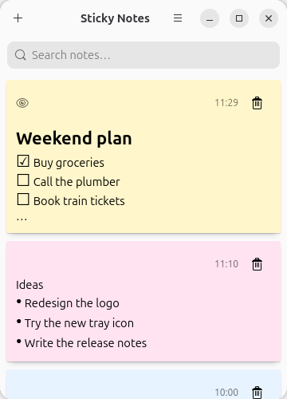
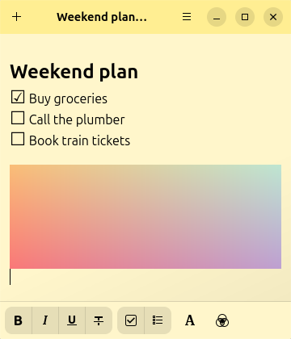

<div align="center">


# Sticky Notes+

[](https://stopthemingmy.app) 

Sticky Notes+ is a note taking application for the GNOME desktop, with images,
twenty colors, checklists and a tray icon. It is written in GJS and uses GTK4.

It is a fork of [Sticky Notes](https://github.com/vixalien/sticky) by Angelo
Verlain and Christopher Davis, and keeps its MIT license.




</div>

## Installation

### Flatpak

Download `it.bwlab.StickyNotes.flatpak` from the
[releases](https://github.com/luigimassa/sticky/releases) and install it:

```sh
flatpak install --user it.bwlab.StickyNotes.flatpak
```

The app id is `it.bwlab.StickyNotes`, so it runs next to the original Sticky
Notes and keeps its own notes. To bring your notes over, copy the `notes` folder
of the original app (`~/.var/app/com.vixalien.sticky/data/com.vixalien.sticky/notes`)
into `~/.var/app/it.bwlab.StickyNotes/data/it.bwlab.StickyNotes/` while neither
app is running, or use *Import Notes…* with a file exported by this app.

### GNOME Shell extension (optional)

Wayland apps cannot stay above other windows or choose where they open, so
those two features come from a small extension in [`extension/`](extension).
Copy it to `~/.local/share/gnome-shell/extensions/sticky-notes-extras@luigimassa.github.io`,
enable it and log out and in again.

The tray icon needs a host for status notifier items, such as the
*AppIndicator and KStatusNotifierItem Support* extension on GNOME.

### From source

To install from source, you need `nodejs` and `yarn` installed. Then, you need
to clone the repository by being careful to also pull in the submodules:

```sh
git clone https://github.com/luigimassa/sticky.git --recurse-submodules
```

Open the project in GNOME Builder and click "Run Project".

> Note: Other non-Flatpak environments are no longer supported. This is because
Sticky Notes uses an upcoming version of libadwaita.
